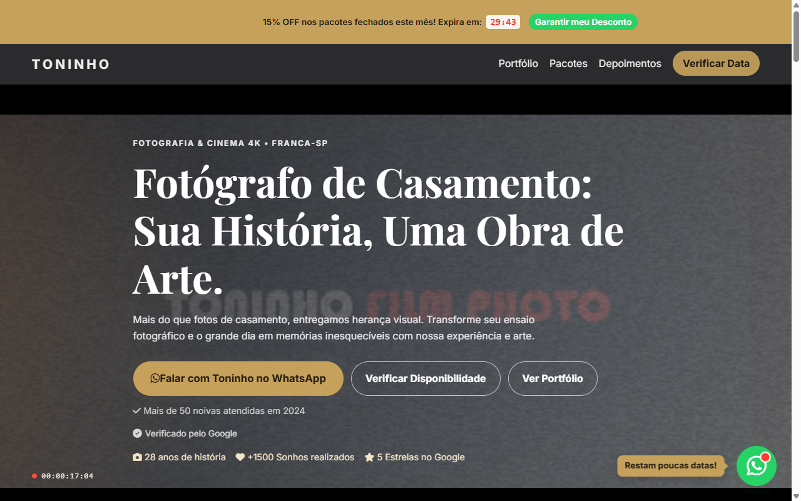
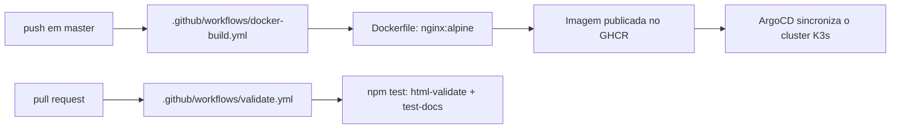

<div align="center">

# 🌐 Site Toninho

**Landing page do Toninho Fotos e Filmagens, para casamentos e eventos em Franca-SP.**<br/>
Site estático em HTML, CSS e JavaScript puros, servido por Nginx em container Docker.

[](https://github.com/juninmd/site-toninho/actions/workflows/validate.yml)
[](LICENSE)

<br/>



</div>

## 📝 Descrição

Este é o site oficial do Toninho, desenvolvido com foco em performance, acessibilidade, SEO e alta conversão. A página apresenta portfólio de casamentos, vídeos e ensaios, informações sobre pacotes/investimento e múltiplos pontos de contato.

Seções da página (`index.html`): hero (vídeo e imagem), sobre, portfólio interativo, CTA do portfólio, como funciona (processo em 4 etapas), serviços e pacotes de investimento, depoimentos de clientes com avaliações verificadas, formulário de contato multi-etapas e FAQ.

## 🛠️ Tech Stack

- **Linguagens**: HTML5, CSS3, JavaScript (ES6+)
- **Estilização**: CSS Puro (Vanilla CSS)
- **Build**: Script `build` no `package.json` copia os arquivos estáticos para a pasta `dist/`
- **Testes**: `npm test` executa `html-validate` sobre `index.html` e validação de documentação em `test-docs.js`
- **Deployment**: Nginx em container Docker (`Dockerfile`) gerenciado via K3s e ArgoCD, com suporte e fallback Jamstack via Netlify.

## ⚙️ Configuração

Para alterar informações essenciais do site (como número do WhatsApp, endereço, textos ou IDs de rastreamento), edite os seguintes locais:

- **WhatsApp**:
  - Lógica principal e envios via JS: Altere `CONFIG.whatsappNumber` no arquivo `script.js` (padrão: `5516999999999`).
  - Links estáticos no HTML: Altere as URLs `https://wa.me/5516999999999` em `index.html`.
  - Redirecionamento `/whatsapp`: Altere em `_redirects`.
- **Endereço e Contato**: Altere as menções de telefone e cidade (Franca-SP) em `index.html`.
- **IDs de Tracking (Analytics / Pixel)**:
  - Google Analytics (`gtag`): Atualize a chave `GA_MEASUREMENT_ID` no `<head>` de `index.html`.
  - Facebook Pixel (`fbq`): Atualize o ID no `<head>` de `index.html`.

> *Nota*: Uma refatoração futura para centralizar essas configurações em um arquivo único `site-config.js` está planejada (consulte a issue correspondente no repositório).

## 📁 Arquitetura de Arquivos

Abaixo está a descrição da estrutura de arquivos do projeto:

| Arquivo / Diretório | Descrição |
| :--- | :--- |
| `index.html` | Página principal e estrutura completa da landing page |
| `custom.css` | Estilos globais e estilização de componentes da landing page |
| `hero-cinema.css` | Estilos específicos para a seção Hero em formato cinema com vídeo |
| `album.css` | Estilos visuais para modal de álbuns e galeria do portfólio |
| `script.js` | Script principal com filtros, formulário multi-etapas, lightbox e integração com WhatsApp |
| `hero-cinema.js` | Lógica de controle e reprodução do player de vídeo hero |
| `album.js` | Lógica de exibição e interação dos modais de detalhes de álbuns |
| `captions.vtt` | Arquivo de legendas para acessibilidade do vídeo hero |
| `fotoAntonio.jpg` | Foto de perfil do Toninho exibida na seção Sobre e no formulário |
| `video.mp4` | Vídeo em alta definição utilizado no background da seção Hero |
| `Dockerfile` | Configuração da imagem Nginx para container Docker |
| `netlify.toml` | Configurações da plataforma Netlify (headers e direcionamentos) |
| `_headers` | Cabeçalhos de segurança HTTP (CSP, HSTS, X-Frame-Options) |
| `_redirects` | Regras de redirecionamento de URLs do Netlify (ex: `/whatsapp`) |
| `sitemap.xml` | Mapa do site para otimização de motores de busca (SEO) |
| `robots.txt` | Regras de indexação para rastreadores de busca |
| `package.json` | Manifesto de dependências e scripts (`build`, `test`) |
| `package-lock.json` | Registro de versões exatas das dependências npm |
| `LICENSE` | Termos da Licença MIT do projeto |
| `SEO_KEYWORDS.md` | Lista de palavras-chave e diretrizes de SEO |
| `test-docs.js` | Script de teste automatizado para validar se todos os arquivos `.js`, `.css` e `.html` estão documentados no `README.md` |

## 🚀 Como Visualizar e Rodar Localmente

Para visualizar e testar o site localmente com total suporte às funcionalidades (como submissão do formulário via `fetch`):

> ⚠️ **Importante**: Abrir o arquivo `index.html` diretamente pelo protocolo de arquivos do navegador (`file://`) impedirá a execução do formulário de contato (`fetch("/")`). É necessário utilizar um servidor HTTP local.

### 1. Clonar o repositório
```bash
git clone https://github.com/juninmd/site-toninho.git
cd site-toninho
```

### 2. Iniciar um servidor HTTP local
Você pode utilizar o Python ou Node.js (`http-server`):

**Usando Python 3**:
```bash
python3 -m http.server 8080
```

**Usando Node.js / npx**:
```bash
npx http-server -p 8080
```

Abra [http://localhost:8080](http://localhost:8080) no seu navegador.

## 🧪 Desenvolvimento e Testes

Para instalar dependências e executar a suíte de validação:

```bash
npm ci          # Instala dependências exatas (html-validate)
npm test        # Executa validação de HTML (html-validate) e teste de documentação (test-docs.js)
npm run build   # Gera a versão final compilada na pasta dist/
```

### Testes End-to-End (E2E)
Testes visuais e de interação podem ser executados via scripts Playwright em `/home/jules/verification/verify.py` para garantir a integridade dos fluxos de conversão e exibição.

## 📦 Deployment e Arquitetura

O projeto suporta duas plataformas de deploy:

1. **Produção Principal (Nginx + K3s)**:
   - **Ambiente Ativo**: O site é servido por um container **Nginx** rodando em cluster **K3s**.
   - **Fluxo CI/CD**: A cada push na branch `master`, o GitHub Actions compila a imagem Docker a partir do `Dockerfile` e a publica no GHCR. O **ArgoCD** sincroniza automaticamente o cluster.
   - **URL de Produção**: [https://site-toninho.antonio-code.duckdns.org](https://site-toninho.antonio-code.duckdns.org)

2. **Hospedagem Estática / Fallback (Netlify)**:
   - Suporta deploy direto via Jamstack utilizando os arquivos `netlify.toml`, `_headers`, `_redirects` e captura nativa de formulários (`data-netlify`).



### Execução via Docker (Local)

Verificado localmente e operacional:

```bash
docker build -t site-toninho .
docker run --rm -p 8080:80 site-toninho
```

## 🔧 Troubleshooting

- **Formulário de contato falha ao enviar**:
  - *Causa*: O arquivo `index.html` foi aberto diretamente via `file://`.
  - *Solução*: Inicie um servidor HTTP local (`python3 -m http.server 8080` ou `npx http-server -p 8080`).
- **Erro `address already in use` ao subir o servidor na porta 8080**:
  - *Causa*: Outro processo já está escutando na porta 8080.
  - *Solução*: Altere a porta utilizada (`python3 -m http.server 8081`) ou encerre o processo com `kill $(lsof -t -i :8080)`.
- **Falha no teste de documentação (`npm test`)**:
  - *Causa*: Um novo arquivo `.js`, `.css` ou `.html` foi adicionado à raiz do projeto sem estar documentado na tabela de arquitetura do `README.md`.
  - *Solução*: Adicione a descrição do novo arquivo na seção "Arquitetura de Arquivos" deste README.
