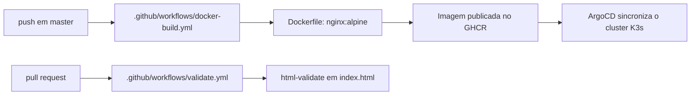

<div align="center">

# 🌐 Site Toninho

**Landing page do Toninho Fotos e Filmagens, para casamentos e eventos em Franca-SP.**<br/>
Site estático em HTML, CSS e JavaScript puros, servido por Nginx em container Docker.

[](https://github.com/juninmd/site-toninho/actions/workflows/validate.yml)
[](LICENSE)

<br/>


</div>

## 📝 Descrição

Este é o site oficial do Toninho, desenvolvido com foco em performance, acessibilidade e design responsivo. A página apresenta informações chave, portfólio e meios de contato de forma elegante.

Seções da página (`index.html`): hero, sobre, portfólio, CTA do portfólio, como funciona, serviços/pacotes, depoimentos, contato e FAQ.

## 🛠️ Tech Stack

- **Linguagens**: HTML5, CSS3, JavaScript (ES6+)
- **Estilização**: CSS Puro (Vanilla)
- **Build**: script `build` do `package.json` copia os arquivos estáticos para `dist/`
- **Testes**: `html-validate` sobre `index.html`
- **Deployment**: Nginx + Docker (`Dockerfile`)

## 🔄 Fluxo



O deploy de produção segue o fluxo acima (AGENTS.md: GitHub Actions + ArgoCD). Os manifestos do ArgoCD não estão neste repositório.

## 🚀 Como Visualizar Localmente

1. Clone o repositório:
   ```bash
   git clone https://github.com/juninmd/site-toninho.git
   ```
2. Abra o arquivo `index.html` no seu navegador ou use uma extensão de "Live Server".

Para gerar a versão de publicação em `dist/`:

```bash
npm run build   # copia os arquivos estáticos para dist/
```

## 🧪 Desenvolvimento

```bash
npm ci          # instala html-validate a partir do package-lock.json
npm test        # valida index.html com html-validate
npm run build   # gera dist/
```

## 📦 Deployment

O site é servido através de um container **Nginx** em um cluster **K3s**.

- **URL de Produção**: [https://site-toninho.antonio-code.duckdns.org](https://site-toninho.antonio-code.duckdns.org)

```bash
docker build -t site-toninho .                 # imagem a partir do Dockerfile
docker run --rm -p 8080:80 site-toninho        # sobe em http://localhost:8080
```

> [!NOTE]
> Comandos Docker ainda não verificados localmente; `npm ci`, `npm test` e `npm run build` foram executados.
